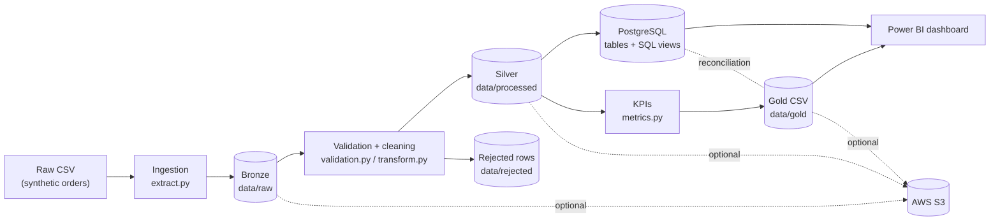

# Pipeline Data Cloud – ETL & Business Intelligence

[](https://github.com/YOUR_GITHUB_USERNAME/pipeline-data-cloud/actions/workflows/ci.yml)


[](LICENSE)

An end-to-end **data engineering pipeline** for e-commerce sales. It ingests a raw CSV file, validates and
cleans it with Python/Pandas, loads it **idempotently** into PostgreSQL, computes business KPIs, and exposes
BI-ready datasets for a Power BI dashboard. An optional module uploads every layer to **AWS S3**.

> **Status.** The pipeline, PostgreSQL loading, tests and linting were executed and verified on Ubuntu 24.04
> (see [Verification status](#verification-status)). Docker Compose, GitHub Actions, real AWS S3 and the
> Power BI report are written but **not executed in the authoring environment**; the limits are listed
> honestly below. The CI badge only works once the repository is published (replace `YOUR_GITHUB_USERNAME`).

## Table of contents

1. [Business problem and objectives](#business-problem-and-objectives)
2. [Features](#features)
3. [Tech stack](#tech-stack)
4. [Architecture](#architecture)
5. [Bronze / Silver / Gold layers](#bronze--silver--gold-layers)
6. [Repository structure](#repository-structure)
7. [Prerequisites](#prerequisites)
8. [Installation (Debian/Ubuntu)](#installation-debianubuntu)
9. [Running the pipeline](#running-the-pipeline)
10. [Tests and code quality](#tests-and-code-quality)
11. [Example results](#example-results)
12. [KPI definitions](#kpi-definitions)
13. [Data quality rules](#data-quality-rules)
14. [Optional: AWS S3](#optional-aws-s3)
15. [Dashboard guide](#dashboard-guide)
16. [Security and secrets](#security-and-secrets)
17. [Verification status](#verification-status)
18. [Roadmap](#roadmap)
19. [Known limitations](#known-limitations)
20. [Author](#author)

## Business problem and objectives

An online retailer receives order exports from its sales system. The files contain duplicates, missing
values, badly formatted dates and numbers, and impossible quantities or prices. Management needs **trusted
revenue figures** (revenue, orders, average basket, trends, regional and category performance) and needs to
know **what was excluded and why**.

Objectives:

- build a reproducible pipeline that runs locally without any paid service or cloud account;
- never silently turn invalid data into valid data: every rejection is traced with a reason code;
- produce analytical tables usable directly by a BI tool, with KPI definitions written down;
- keep infrastructure (PostgreSQL, S3) separate from business logic, and test everything that can be tested.

## Features

- **Reproducible synthetic dataset** (≈5,000 orders, fixed seed) with deliberately injected anomalies and a
  manifest (ground truth) recording how many of each were injected. Tests check that the pipeline detects
  *exactly* those anomalies.
- **Bronze / Silver / Gold** layers with explicit schema, type, business-rule and deduplication handling.
- **Rejected-rows audit trail** (`data/rejected/rejected_rows.csv` and a PostgreSQL table) with raw values.
- **Data quality report** (JSON) with counts of rejections, normalisations and `Unknown` replacements.
- **Idempotent PostgreSQL load** (`COPY` + `INSERT … ON CONFLICT`) in a single transaction, with constraints,
  indexes and analytical views.
- **SQL ↔ pandas reconciliation**: after every load the KPIs computed by the SQL views are compared with the
  Gold CSV figures; a mismatch fails the run.
- **Optional AWS S3 upload** (Boto3, disabled by default, no credential in the repository).
- **Docker Compose** environment with a health-checked PostgreSQL and a persistent volume.
- **Pytest suite** (181 tests), **Ruff** linting and a **GitHub Actions** workflow.

## Tech stack

| Area | Technology |
|------|-----------|
| Language | Python 3.12 (3.11+ supported by `pyproject.toml`) |
| Data processing | Pandas 3, NumPy |
| Database | PostgreSQL 16, `psycopg2` |
| Containers | Docker, Docker Compose |
| Cloud (optional) | AWS S3, Boto3 |
| BI | Power BI (guide in [`dashboard/powerbi.md`](dashboard/powerbi.md)) |
| Quality | Pytest, moto (S3 mocks), Ruff, GitHub Actions |

## Architecture



Details, responsibilities and design choices: [`docs/architecture.md`](docs/architecture.md).

## Bronze / Silver / Gold layers

| Layer | Location | Content | Rules |
|-------|----------|---------|-------|
| **Bronze** | `data/raw/` | `orders_raw.csv` (source, never modified) and `orders_bronze.csv` (same values + `_source_file`, `_run_id`, `_ingested_at`, `_row_number`) | Values are read as text and kept unchanged. An existing raw file is never overwritten unless `--regenerate` is used. |
| **Silver** | `data/processed/`, `data/rejected/` | `orders_clean.csv`, `data_quality_report.json`, `rejected_rows.csv` | Schema check, type conversion, business rules, deduplication, `total_amount` recomputed. |
| **Gold** | `data/gold/` | 7 BI-ready CSV files (UTF-8 with BOM) | KPIs computed from Silver only. Mirrored by SQL views in PostgreSQL. |

## Repository structure

```text
pipeline-data-cloud/
├── README.md  LICENSE  Makefile  pyproject.toml
├── requirements.txt  requirements-dev.txt
├── Dockerfile  docker-compose.yml  .dockerignore  .env.example  .gitignore
├── .github/workflows/ci.yml        # lint + tests (with PostgreSQL service) + Docker build
├── src/
│   ├── config.py                   # settings from environment variables
│   ├── logger.py                   # console + file logging
│   ├── extract.py                  # synthetic data, raw reading, Bronze
│   ├── validation.py               # schema + business rules (pure functions)
│   ├── transform.py                # Silver: cleaning, dedup, rejection, quality report
│   ├── metrics.py                  # Gold KPIs
│   ├── load.py                     # file exports + PostgreSQL load + reconciliation
│   ├── s3_storage.py               # optional AWS S3 upload
│   └── main.py                     # orchestration + CLI
├── sql/schema.sql  sql/analytics.sql
├── tests/                          # 181 tests (6 need PostgreSQL)
├── dashboard/powerbi.md
├── docs/architecture.md  data_dictionary.md  workflow.md  aws_migration.md
└── data/README.md                  # generated data is git-ignored
```

## Prerequisites

| Tool | Needed for | Check |
|------|-----------|-------|
| Python ≥ 3.11 (3.12 tested) with `venv` | local mode | `python3 --version` |
| `make`, `git` | shortcuts, versioning | `make --version` |
| Docker Engine + Compose v2 | Docker mode, local PostgreSQL | `docker compose version` |
| AWS CLI + account | optional S3 only | `aws --version` |

## Installation (Debian/Ubuntu)

```bash
sudo apt update
sudo apt install -y python3 python3-venv python3-pip make git
# Docker (optional): follow https://docs.docker.com/engine/install/debian/ then:
# sudo usermod -aG docker "$USER"   # log out/in afterwards

git clone https://github.com/YOUR_GITHUB_USERNAME/pipeline-data-cloud.git
cd pipeline-data-cloud

make install          # creates .venv and installs requirements-dev.txt
cp .env.example .env  # then edit POSTGRES_PASSWORD (placeholder value only)
```

## Running the pipeline

### Mode 1 – Local Python (virtual environment)

Files only, no database required:

```bash
make run              # == .venv/bin/python -m src.main --skip-db
```

With PostgreSQL (start a database first, e.g. `make db-up`, which needs Docker):

```bash
make db-up            # PostgreSQL in Docker, waits for the healthcheck
make run-db           # == .venv/bin/python -m src.main --load-db
```

Useful flags: `--regenerate` (rebuild the synthetic raw file), `--skip-db`, `--load-db`, `--s3`.
Without Docker you can point `POSTGRES_*` at any PostgreSQL 14+ instance you control.

### Mode 2 – Docker (PostgreSQL + pipeline)

```bash
cp .env.example .env            # set POSTGRES_PASSWORD
make docker-run                 # builds the image, starts PostgreSQL, waits until healthy, runs the pipeline
make psql                       # optional: SQL shell
make docker-down                # stop (data persisted in the `pgdata` volume)
make docker-reset               # stop and DELETE the database volume
```

Equivalent raw commands: `docker compose up -d db` then `docker compose run --rm app`.
The `app` container waits for the database (`depends_on: service_healthy`) and the application also retries
the connection (`DB_CONNECT_RETRIES`, `DB_CONNECT_DELAY_SECONDS`).

## Tests and code quality

```bash
make test               # pytest (PostgreSQL integration tests are skipped if no test DB is configured)
make lint               # ruff check + ruff format --check
make check              # both

# Include the PostgreSQL integration tests (use a dedicated database whose name ends with _test):
TEST_POSTGRES_HOST=localhost TEST_POSTGRES_PORT=5432 TEST_POSTGRES_DB=ecommerce_test \
TEST_POSTGRES_USER=pipeline TEST_POSTGRES_PASSWORD='your_local_password' make test
```

The S3 tests use [moto](https://github.com/getmoto/moto) and fake credentials: **no AWS account is needed**.
The integration fixtures refuse to run on a database whose name does not end with `_test`, because they drop
the `ecommerce` schema.

## Example results

Produced by a real run of `python -m src.main --load-db` (seed 42, PostgreSQL 16.15), then verified: the
total revenue matches an independent recomputation with `decimal`, and the SQL views match the Gold CSV files.

**Pipeline accounting**

| Raw rows | Clean (Silver) | Rejected | Of which duplicates | Rejection rate |
|---------:|---------------:|---------:|--------------------:|---------------:|
| 5,075 | 4,884 | 191 | 75 | 3.76 % |

A second run on the same data reported `0 inserted, 0 updated, 4884 unchanged` in PostgreSQL (idempotent).

**Headline KPIs** (`kpi_summary.csv`)

| Total revenue | Orders | Average order value | Unique customers | Units sold | Period |
|--------------:|-------:|--------------------:|-----------------:|-----------:|--------|
| 618,065.97 | 4,884 | 126.55 | 1,187 | 8,722 | 2024-01-01 → 2025-06-30 |

**Sales by category** (`sales_by_category.csv`)

| Category | Revenue | Orders | Share |
|----------|--------:|-------:|------:|
| Electronics | 231,263.04 | 1,232 | 37.42 % |
| Home & Kitchen | 165,376.75 | 970 | 26.76 % |
| Fashion | 85,302.81 | 1,082 | 13.80 % |
| Sports | 59,149.75 | 563 | 9.57 % |
| Beauty | 41,942.05 | 523 | 6.79 % |
| Books | 32,168.93 | 484 | 5.20 % |
| Unknown | 2,862.64 | 30 | 0.46 % |

**Top 5 products by revenue** (`top_products.csv`)

| Rank | Product | Revenue |
|-----:|---------|--------:|
| 1 | 27-inch Monitor | 98,237.23 |
| 2 | Robot Vacuum | 83,895.23 |
| 3 | Noise-Cancelling Headphones | 54,163.36 |
| 4 | Air Fryer | 37,588.45 |
| 5 | Mechanical Keyboard | 33,945.09 |

**Payment methods** (share of orders): Credit Card 41.20 %, PayPal 21.07 %, Debit Card 20.35 %,
Apple Pay 10.20 %, Bank Transfer 6.45 %, Unknown 0.74 %.

Seasonality is visible in `monthly_sales.csv` (the data generator deliberately adds a November/December
peak): 48,002.65 in 2024-11 and 50,174.79 in 2024-12, versus 28,431.91 in 2025-01. These are synthetic
data: the figures illustrate the pipeline, not a real business.

Excerpt of the SQL result for rejections (`SELECT * FROM ecommerce.v_rejections_by_reason`):

| reject_reason | rows_count |
|---------------|-----------:|
| DUPLICATE_EXACT | 60 |
| MISSING_CUSTOMER_ID | 20 |
| QUANTITY_OUT_OF_RANGE | 16 |
| DUPLICATE_ORDER_ID_CONFLICT | 15 |
| INVALID_ORDER_DATE | 15 |
| UNIT_PRICE_OUT_OF_RANGE | 14 |
| … | … |

## KPI definitions

All KPIs use **validated orders only** (Silver). Formulas are implemented twice (pandas in `src/metrics.py`,
SQL in `sql/analytics.sql`) and reconciled.

| KPI | Definition | Gold file / SQL view |
|-----|-----------|----------------------|
| Total revenue | `SUM(total_amount)` | `kpi_summary` / `v_kpi_summary` |
| Orders | count of distinct `order_id` | `kpi_summary` |
| Average order value (basket) | total revenue ÷ orders | `kpi_summary` |
| Monthly revenue | revenue grouped by month of `order_date`; `revenue_mom_pct = (m − m₋₁) ÷ m₋₁ × 100` | `monthly_sales` / `v_monthly_sales` |
| Orders trend | monthly orders, MoM %, 3-month moving average, cumulative total | `orders_trend` / `v_orders_trend` |
| Sales by region / category | revenue, orders, AOV, `revenue_share_pct = group ÷ total × 100` | `sales_by_region`, `sales_by_category` |
| Top 10 products | ranked by revenue, ties broken alphabetically | `top_products` / `v_top_products` |
| Payment methods | orders, share of orders, revenue | `payment_methods` / `v_payment_methods` |

`total_amount` is always recomputed as `quantity × unit_price` (rounded to cents); the value found in the raw
file is never trusted. No taxes, discounts, shipping or refunds are modelled.

## Data quality rules

| Rule | Treatment |
|------|-----------|
| Missing `order_id`, `customer_id`, `order_date`, `product_name`, `quantity`, `unit_price` (also `N/A`, `NULL`, `-`) | **Rejected** (`MISSING_*`) |
| Date not `YYYY-MM-DD` nor `DD/MM/YYYY` (e.g. `31-02-2024`, `2024-02-30`, `03/15/2025`) | **Rejected** (`INVALID_ORDER_DATE`); `MM/DD` is never guessed |
| `DD/MM/YYYY` date (French convention of the source) | Converted, **counted** in the report |
| Date before 2020-01-01 or after the run date | **Rejected** (`ORDER_DATE_OUT_OF_RANGE`) |
| Quantity not a whole number, or outside 1–100 | **Rejected** (`INVALID_QUANTITY`, `QUANTITY_OUT_OF_RANGE`) |
| Unit price not a number, or outside 0.01–10,000.00 | **Rejected** (`INVALID_UNIT_PRICE`, `UNIT_PRICE_OUT_OF_RANGE`) |
| Decimal comma (`12,50`) or `3.0` quantity | Converted, **counted**; `1,234.50` stays invalid (ambiguous) |
| Missing `category`, `payment_method`, `city`, `region` | Kept with the value `Unknown`, **counted** |
| Payment method with different case/spaces | Standardised; unrecognised value (`Bitcoin`) → `Unknown`, counted |
| `total_amount` missing or inconsistent | **Recomputed**, counted separately |
| Identical rows (after normalisation) | First kept, others rejected (`DUPLICATE_EXACT`) |
| Same `order_id`, different content | First kept, others rejected (`DUPLICATE_ORDER_ID_CONFLICT`) |

Why “first occurrence wins”: the source has no reliable update timestamp, so the pipeline keeps the earliest
record and exposes the conflicting ones in the rejected file for human review. Full column-level rules:
[`docs/data_dictionary.md`](docs/data_dictionary.md).

## Optional: AWS S3

Disabled by default; the pipeline and all tests work without AWS. To enable:

```bash
aws configure                     # or: aws configure sso   (credentials stay in ~/.aws, never in the repo)
aws s3api create-bucket --bucket YOUR-UNIQUE-BUCKET --region eu-west-3 \
    --create-bucket-configuration LocationConstraint=eu-west-3
aws s3api put-public-access-block --bucket YOUR-UNIQUE-BUCKET \
    --public-access-block-configuration BlockPublicAcls=true,IgnorePublicAcls=true,BlockPublicPolicy=true,RestrictPublicBuckets=true

# in .env
S3_ENABLED=true
S3_BUCKET=YOUR-UNIQUE-BUCKET
S3_PREFIX=ecommerce-pipeline
AWS_REGION=eu-west-3

# upload every layer after the run (or simply keep S3_ENABLED=true in .env):
.venv/bin/python -m src.main --skip-db --s3
```

Objects are written to `s3://<bucket>/<prefix>/<layer>/run_date=YYYY-MM-DD/<file>` with server-side
encryption (SSE-S3); errors (no credentials, missing bucket, access denied, network) produce explicit
messages. Costs, IAM policy and cleanup: [`docs/aws_migration.md`](docs/aws_migration.md).
**This upload path is covered by moto-based tests but has not been run against a real AWS account.**

## Dashboard guide

Gold CSV files and PostgreSQL views feed the dashboard. The step-by-step Power BI guide (connection, model,
DAX measures, visuals) is in [`dashboard/powerbi.md`](dashboard/powerbi.md). Power BI Desktop is Windows-only,
so the guide lists realistic options from Debian (Windows VM, Power BI Service in the browser, or a
complementary web dashboard). **No `.pbix` file and no screenshot is included, because none was created.**

## Security and secrets

- No password, key or token in the code. `.env` is git-ignored; `.env.example` contains placeholders only.
- PostgreSQL has no default password: the app refuses to load the database without `POSTGRES_PASSWORD`.
- Docker publishes PostgreSQL on `127.0.0.1` only, and the app container runs as a non-root user.
- AWS credentials are resolved by Boto3's standard chain (profile, SSO, IAM role); never put them in `.env`.
- Use least-privilege IAM, block public access on the bucket and enable encryption (see `docs/aws_migration.md`).
- Raw data is synthetic: no personal data is stored. Real customer data would require GDPR measures
  (pseudonymisation, retention, access control).
- Before publishing, run `git status` and `git diff --cached` to check that no `.env` or data file is staged.

## Verification status

| Item | Status |
|------|--------|
| Pipeline, Bronze/Silver/Gold files | ✅ run locally, results above |
| Tests (181) and Ruff | ✅ executed (Ubuntu 24.04, Python 3.12.3) |
| PostgreSQL schema, load, idempotence, views, SQL ↔ Gold reconciliation | ✅ run on PostgreSQL 16.15 installed from apt |
| S3 module | ✅ tested with moto mocks; ❌ not tested on real AWS |
| `Dockerfile`, `docker-compose.yml` | ⚠️ written and YAML-validated, **not executed** (Docker unavailable where the project was authored) |
| GitHub Actions workflow | ⚠️ YAML-validated; **has never run** until pushed |
| Power BI report | ❌ not created (documentation only) |

First thing to do on your machine: `make docker-run`, and check the Actions tab after the first push.

## Roadmap

- [ ] Run and confirm Docker Compose and the CI workflow on a first push.
- [ ] Build the Power BI report from the guide and add screenshots to `dashboard/screenshots/`.
- [ ] Add Parquet outputs and partitioning for larger volumes.
- [ ] Schedule runs (cron, then Airflow or a managed scheduler).
- [ ] Add data-contract checks with a library such as Great Expectations or Pandera.
- [ ] Optional AWS target: S3 + Athena/Glue or Redshift, provisioned with Terraform.
- [ ] Complementary lightweight web dashboard (Streamlit or similar) for Linux-only users.

## Known limitations

- Synthetic data: results illustrate the pipeline, not real commerce.
- Full-refresh batch processing in memory (fine for thousands of rows, not for hundreds of millions).
- Orders that disappear from a later source file are **not** deleted from PostgreSQL.
- `run_id` in `ecommerce.orders` is the run that last *changed* the row, not the last run that saw it.
- The `DD/MM/YYYY` assumption is specific to the (synthetic) source; another source needs its own rule.
- Revenue ignores tax, discounts, currency conversion and returns.
- Pipeline failures are logged and return a non-zero exit code, but a `FAILED` row is not written to `pipeline_runs`.
- Rejected rows are replaced per source file at each load (audit snapshot), not accumulated across files.

## Author

Bilal CHAOUI  – Computer Science Engineering student

- GitHub: [github.com/LILIBE-art](https://github.com/LILBE-art)
- LinkedIn: [linkedin.com/in/Bilal CHAOUI](https://www.linkedin.com/in/bilal-chaoui-491707228)


Released under the [MIT License](LICENSE).
