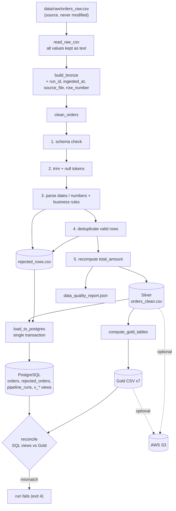

# Architecture

## Goals

* Run entirely on a laptop (Debian/Ubuntu) without paid services or cloud accounts.
* Keep business rules (pure pandas functions) separate from infrastructure (PostgreSQL, S3).
* Make every decision about the data traceable: nothing is dropped or fixed silently.

## Components and responsibilities

| Module | Responsibility | Touches I/O? |
|--------|----------------|--------------|
| `src/config.py` | Reads and validates environment variables into an immutable `Settings` object. No secret has a default. | env only |
| `src/logger.py` | Console + `logs/pipeline.log` logging, idempotent configuration. | file |
| `src/extract.py` | Generates the synthetic dataset (fixed seed) with injected anomalies and a manifest; reads raw CSV as text; builds Bronze (adds metadata). | files |
| `src/validation.py` | Schema check, parsers (dates, numbers), row-level business rules, reason codes. | **no** |
| `src/transform.py` | Orchestrates Silver: normalisation, deduplication, rejection, `total_amount` recomputation, quality report. | **no** |
| `src/metrics.py` | Gold KPIs from the Silver table. | **no** |
| `src/load.py` | CSV/JSON exports, PostgreSQL load (idempotent upsert), SQL ↔ Gold reconciliation. | files, DB |
| `src/s3_storage.py` | Optional S3 upload with explicit error translation. | network |
| `src/main.py` | Orchestration, CLI, exit codes (0 ok, 2 config, 3 input data, 4 infrastructure). | – |
| `sql/schema.sql`, `sql/analytics.sql` | Versioned DDL (tables, constraints, indexes) and analytical views. | – |

Only `extract`, `load`, `s3_storage` and `main` perform I/O; `validation`, `transform` and `metrics` are pure,
which is why they are covered by fast unit tests that need no database or network.

## Data flow

## Key design decisions

1. **Raw is immutable.** `orders_raw.csv` is only created if absent (or with `--regenerate`). Bronze is a copy
   plus metadata, so every rejected row can be traced back to its line in the source (`source_row`).
2. **Everything is read as text first.** Type conversion happens in Silver, where failures become explicit
   reason codes instead of silent `NaN`.
3. **Row accounting invariant.** `rows_clean + rows_rejected == rows_raw` is enforced (a `RuntimeError` is raised otherwise).
4. **Money is computed in integer cents** (`quantity × round(price × 100)`) to avoid floating-point drift.
5. **Gold is computed in pandas, served by SQL views, and reconciled.** The SQL layer is what a BI tool can
   query live; the pandas layer produces files that work without any database. After every load both
   implementations are compared (tolerance 0.011 for rounding). Disagreement is treated as a failure, because
   two definitions of the same KPI that silently diverge are a classic BI incident.
6. **Idempotent load.** Rows are staged with `COPY`, merged with `INSERT … ON CONFLICT (order_id) DO UPDATE …
   WHERE (row) IS DISTINCT FROM (excluded row)`. Re-running inserts and updates nothing. The whole load is
   one transaction (commit or rollback).
7. **Database constraints duplicate the business rules** (`CHECK` on quantity, price range and
   `total_amount = round(quantity × unit_price, 2)`), so the database stays correct even if another
   producer writes to it.
8. **S3 is a plug-in.** `S3Storage` receives a client (or builds a default one), so tests inject moto/mocks.
   Credentials come only from the standard AWS chain.
9. **Reproducibility:** pinned dependencies, fixed seed, deterministic ordering and tie-breaks (`ORDER BY revenue DESC, name`).

## Failure behaviour

| Situation | Behaviour |
|-----------|-----------|
| Invalid configuration | message on stderr, exit code 2 |
| Missing/corrupt raw file or missing required column | logged, exit code 3 |
| PostgreSQL unreachable after the retry policy / SQL error / reconciliation mismatch | logged, transaction rolled back, exit code 4 |
| S3 credentials, permission or network error | explicit message, exit code 4 (local files and database are already written) |
